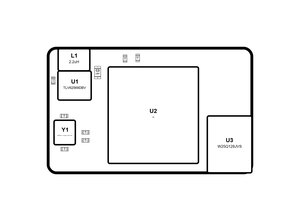
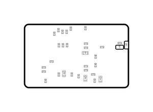
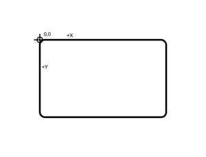

# Project adafruit/kicad-libraries Minimal P4 current

[View the project on GitHub](https://github.com/adafruit/kicad-libraries/blob/main/design_blocks/Espressif.kicad_blocks/Minimal%20P4%20V3.kicad_block/Minimal%20P4%20V3.kicad_pcb)

[Open the interactive board explorer (GitHub Pages)](https://oomlout.github.io/oomp_electronic_project_version_5/parts/oomp_project_github_adafruit_kicad_libraries_minimal_p4_current/board_explorer.html)

[Browse this project category](../../navigation/oomp/project/github/adafruit/kicad_libraries/minimal_p4/README.md)

Project adafruit/kicad-libraries Minimal P4 current is a KiCad project containing 85 extracted component records. The catalogue matcher linked 38 physical placements to OOMP parts.

## Project snapshot

| Item | Count |
| --- | ---: |
| Components | 85 |
| PCB footprints | 45 |
| Mounting and locating holes | 0 |
| Matched OOMP mounting-hole items | 0 |
| Schematic symbols | 85 |
| Matched OOMP components | 38 |
| Unmatched physical components | 7 |
| Front-side placements | 13 |
| Back-side placements | 32 |
| Project version | `current` |
| Git ref | `main` |

## Board

[Original KiCad files](https://github.com/oomlout/oomp_electronic_project_version_5/tree/main/parts/oomp_project_github_adafruit_kicad_libraries_minimal_p4_current/data/original) · [OOMP KiCad design and local libraries](https://github.com/oomlout/oomp_electronic_project_version_5/tree/main/parts/oomp_project_github_adafruit_kicad_libraries_minimal_p4_current/data/oomp_design) · [Conversion / skipped-item report](https://github.com/oomlout/oomp_electronic_project_version_5/blob/main/parts/oomp_project_github_adafruit_kicad_libraries_minimal_p4_current/data/oomp_design/conversion_report.yaml)

The OOMP design is a separate copy. Only symbols and footprints verified against unchanged installed KiCad masters are replaced; custom and modified items are retained.

- Approximate size: **25.3852 mm × 15.5286 mm**
- Outline source: `placed component extents`
- Placement drawing: [view `board.svg`](https://github.com/oomlout/oomp_electronic_project_version_5/blob/main/parts/oomp_project_github_adafruit_kicad_libraries_minimal_p4_current/data/generated_data/src/board.svg)
- PNG placement drawing: [view `board.png`](https://github.com/oomlout/oomp_electronic_project_version_5/blob/main/parts/oomp_project_github_adafruit_kicad_libraries_minimal_p4_current/data/generated_data/src/board.png)
- 300-pixel placement preview: [view `board_300.png`](https://github.com/oomlout/oomp_electronic_project_version_5/blob/main/parts/oomp_project_github_adafruit_kicad_libraries_minimal_p4_current/data/generated_data/src/board_300.png)
- Placement drawing with pin names: [view `board_pins.svg`](https://github.com/oomlout/oomp_electronic_project_version_5/blob/main/parts/oomp_project_github_adafruit_kicad_libraries_minimal_p4_current/data/generated_data/src/board_pins.svg)
- PNG drawing with pin names: [view `board_pins.png`](https://github.com/oomlout/oomp_electronic_project_version_5/blob/main/parts/oomp_project_github_adafruit_kicad_libraries_minimal_p4_current/data/generated_data/src/board_pins.png)
- 300-pixel pin preview: [view `board_pins_300.png`](https://github.com/oomlout/oomp_electronic_project_version_5/blob/main/parts/oomp_project_github_adafruit_kicad_libraries_minimal_p4_current/data/generated_data/src/board_pins_300.png)
- Bottom placement drawing: [view `board_bottom.svg`](https://github.com/oomlout/oomp_electronic_project_version_5/blob/main/parts/oomp_project_github_adafruit_kicad_libraries_minimal_p4_current/data/generated_data/src/board_bottom.svg)
- Bottom PNG placement drawing: [view `board_bottom.png`](https://github.com/oomlout/oomp_electronic_project_version_5/blob/main/parts/oomp_project_github_adafruit_kicad_libraries_minimal_p4_current/data/generated_data/src/board_bottom.png)
- 300-pixel bottom preview: [view `board_bottom_300.png`](https://github.com/oomlout/oomp_electronic_project_version_5/blob/main/parts/oomp_project_github_adafruit_kicad_libraries_minimal_p4_current/data/generated_data/src/board_bottom_300.png)
- Bottom placement drawing with pin names: [view `board_pins_bottom.svg`](https://github.com/oomlout/oomp_electronic_project_version_5/blob/main/parts/oomp_project_github_adafruit_kicad_libraries_minimal_p4_current/data/generated_data/src/board_pins_bottom.svg)
- Bottom PNG drawing with pin names: [view `board_pins_bottom.png`](https://github.com/oomlout/oomp_electronic_project_version_5/blob/main/parts/oomp_project_github_adafruit_kicad_libraries_minimal_p4_current/data/generated_data/src/board_pins_bottom.png)
- 300-pixel bottom pin preview: [view `board_pins_bottom_300.png`](https://github.com/oomlout/oomp_electronic_project_version_5/blob/main/parts/oomp_project_github_adafruit_kicad_libraries_minimal_p4_current/data/generated_data/src/board_pins_bottom_300.png)
- Mechanical drawing: [view `board_mechanical.svg`](https://github.com/oomlout/oomp_electronic_project_version_5/blob/main/parts/oomp_project_github_adafruit_kicad_libraries_minimal_p4_current/data/generated_data/src/board_mechanical.svg)
- Mechanical PNG: [view `board_mechanical.png`](https://github.com/oomlout/oomp_electronic_project_version_5/blob/main/parts/oomp_project_github_adafruit_kicad_libraries_minimal_p4_current/data/generated_data/src/board_mechanical.png)
- 300-pixel mechanical preview: [view `board_mechanical_300.png`](https://github.com/oomlout/oomp_electronic_project_version_5/blob/main/parts/oomp_project_github_adafruit_kicad_libraries_minimal_p4_current/data/generated_data/src/board_mechanical_300.png)
- Open the board explorer on GitHub Pages: [explore this board](https://oomlout.github.io/oomp_electronic_project_version_5/parts/oomp_project_github_adafruit_kicad_libraries_minimal_p4_current/board_explorer.html)
- InteractiveHtmlBom generation is configured; install KiCad or set `KICAD_PYTHON` to its bundled Python to build `data/interactivehtmlbom/ibom.html`.

## Board with pins

## Bottom board with pins

The bottom view is mirrored horizontally so it is shown as viewed from beneath the assembled board.

## Mechanical layer

The table uses a board-relative origin at the minimum X/Y point of `Edge.Cuts`. This point is shown as **0,0** in the mechanical drawing; X increases right and Y increases down. Original KiCad coordinates are retained alongside it.

## Bill of materials

| References | Quantity | Description | Value | Footprint | OOMP part |
| --- | ---: | --- | --- | --- | --- |
| C1, C42 | 2 | Capacitor 4.7 uF 0402 | 4.7uF | `Capacitor_SMD:C_0402_1005Metric` | [`electronic_capacitor_0402_4_7_micro_farad`](https://github.com/oomlout/oomp_electronic_version_5/tree/main/parts/electronic_capacitor_0402_4_7_micro_farad) |
| C2 | 1 | Capacitor 22 pF 0402 | 22pF | `Capacitor_SMD:C_0402_1005Metric` | [`electronic_capacitor_0402_22_pico_farad`](https://github.com/oomlout/oomp_electronic_version_5/tree/main/parts/electronic_capacitor_0402_22_pico_farad) |
| C3 | 1 | Capacitor 22 uF 0603 | 22uF | `Capacitor_SMD:C_0603_1608Metric` | [`electronic_capacitor_0603_22_micro_farad`](https://github.com/oomlout/oomp_electronic_version_5/tree/main/parts/electronic_capacitor_0603_22_micro_farad) |
| C4, C5 | 2 | Capacitor 12 pF 0402 | 12pF | `Capacitor_SMD:C_0402_1005Metric` | [`electronic_capacitor_0402_12_pico_farad`](https://github.com/oomlout/oomp_electronic_version_5/tree/main/parts/electronic_capacitor_0402_12_pico_farad) |
| C6, C7, C8, C9, C12, C13, C15, C16, C21, C23, C24, C25, C26, C31, C32, C33, C40 | 17 | Capacitor 100 nF 0402 | 0.1uF | `Capacitor_SMD:C_0402_1005Metric` | [`electronic_capacitor_0402_100_nano_farad`](https://github.com/oomlout/oomp_electronic_version_5/tree/main/parts/electronic_capacitor_0402_100_nano_farad) |
| C11, C14, C20, C28 | 4 | Capacitor 10 uF 0603 | 10uF | `Capacitor_SMD:C_0603_1608Metric` | [`electronic_capacitor_0603_10_micro_farad`](https://github.com/oomlout/oomp_electronic_version_5/tree/main/parts/electronic_capacitor_0603_10_micro_farad) |
| C17, C18, C27, C29, C30 | 5 | Capacitor 1 uF 0402 | 1uF | `Capacitor_SMD:C_0402_1005Metric` | [`electronic_capacitor_0402_1_micro_farad`](https://github.com/oomlout/oomp_electronic_version_5/tree/main/parts/electronic_capacitor_0402_1_micro_farad) |
| C41 | 1 | Capacitor 10 nF 0402 | 10nF | `Capacitor_SMD:C_0402_1005Metric` | [`electronic_capacitor_0402_10_nano_farad`](https://github.com/oomlout/oomp_electronic_version_5/tree/main/parts/electronic_capacitor_0402_10_nano_farad) |
| L1 | 1 | 2.2uH | 2.2uH | `Inductor_SMD:L_1008_2520Metric` | unmatched |
| R1, R2 | 2 | 499k | 499k | `Resistor_SMD:R_0402_1005Metric` | unmatched |
| R3, R4, R39 | 3 | Resistor 0 Ohm 0402 | 0 | `Resistor_SMD:R_0402_1005Metric` | [`electronic_resistor_0402_0_ohm`](https://github.com/oomlout/oomp_electronic_version_5/tree/main/parts/electronic_resistor_0402_0_ohm) |
| R28, R200 | 2 | Resistor 10000 Ohm 0402 | 10k | `Resistor_SMD:R_0402_1005Metric` | [`electronic_resistor_0402_10000_ohm`](https://github.com/oomlout/oomp_electronic_version_5/tree/main/parts/electronic_resistor_0402_10000_ohm) |
| U1 | 1 | TLV62569DBV | TLV62569DBV | `Package_TO_SOT_SMD:SOT-23-5` | unmatched |
| U2 | 1 | ~ | ~ | `Espressif:ESP32-P4` | unmatched |
| U3 | 1 | W25Q128JVS | W25Q128JVS | `Package_SON:WSON-8-1EP_6x5mm_P1.27mm_EP3.4x4.3mm` | unmatched |
| Y1 | 1 | 40MHz(+-10 ppm) C501798 | 40MHz(+-10 ppm) C501798 | `Crystal:Crystal_SMD_2016-4Pin_2.0x1.6mm` | unmatched |

## Main nets

| Net | Pads | Components |
| --- | ---: | --- |
| `GND` | 46 | C1, C3, C4, C5, C6, C7, C8, C9, C11, C12, C13, C14, C15, C16, C17, C18, C20, C21, C23, C24, C25, C26, C27, C28, C29, C30, C31, C32, C33, C40, C41, C42, R2, U1, U2, U3, Y1 |
| `+3.3V` | 28 | C1, C6, C7, C9, C11, C12, C13, C14, C16, C20, C21, C23, C24, C40, C41, C42, R200, U1, U2 |
| `/Minimal P4 V3/VDD_HP` | 12 | C2, C3, C8, C15, C28, C29, L1, R1, R39, U2 |
| `/Minimal P4 V3/VDD_FLASH` | 8 | C17, C30, C31, C32, R28, U2, U3 |
| `/Minimal P4 V3/VDDO_PSRAM` | 6 | C18, C26, C27, U2 |
| `/Minimal P4 V3/FB_DCDC` | 5 | C2, R1, R2, U1, U2 |
| `/Minimal P4 V3/FLASH_CS` | 3 | R28, U2, U3 |
| `/RESET` | 3 | C33, R200, U2 |
| `Net-(C4-Pad2)` | 3 | C4, R3, Y1 |
| `Net-(C5-Pad1)` | 3 | C5, R4, Y1 |
| `Net-(U2-VDD_HP_1)` | 3 | C25, R39, U2 |
| `/Minimal P4 V3/EN_DCDC` | 2 | U1, U2 |
| `/Minimal P4 V3/FLASH_CK` | 2 | U2, U3 |
| `/Minimal P4 V3/FLASH_D` | 2 | U2, U3 |
| `/Minimal P4 V3/FLASH_HOLD` | 2 | U2, U3 |
| `/Minimal P4 V3/FLASH_Q` | 2 | U2, U3 |
| `/Minimal P4 V3/FLASH_WP` | 2 | U2, U3 |
| `Net-(U1-SW)` | 2 | L1, U1 |
| `Net-(U2-XTAL_N)` | 2 | R4, U2 |
| `Net-(U2-XTAL_P)` | 2 | R3, U2 |

## Design notes

- The extracted board outline is approximately 25.3852 mm by 15.5286 mm.
- Placement data contains 13 front-side and 32 back-side components.

## Review notes

- 7 physical component records are not yet matched to an OOMP part.
- The extractor reports 106 named-net comparisons that differ between schematic and PCB data.

- Part identities needing a manufacturer/LCSC decision: [`lcsc_review.yaml`](https://github.com/oomlout/oomp_electronic_project_version_5/blob/main/parts/oomp_project_github_adafruit_kicad_libraries_minimal_p4_current/data/generated_data/lcsc_review.yaml)
- Browser-only research and datasheet queue: [`browser_research_queue.md`](https://github.com/oomlout/oomp_electronic_project_version_5/blob/main/parts/oomp_project_github_adafruit_kicad_libraries_minimal_p4_current/data/generated_data/browser_research_queue.md)

## Generated source bundle

- Project image assets: [`data/generated_data/src`](https://github.com/oomlout/oomp_electronic_project_version_5/tree/main/parts/oomp_project_github_adafruit_kicad_libraries_minimal_p4_current/data/generated_data/src)
- Copied component source manifest: `data/project_source/manifest.yaml` (generated locally and ignored by Git)
- Matched OOMP source parts copied: 10

## Source files

- Schematic: `data/kicad_file.kicad_sch`
- PCB: `data/kicad_file.kicad_pcb`

---

Generated deterministically by `kicad_agents.project_summary_agent`; no LLM-authored content is used.
